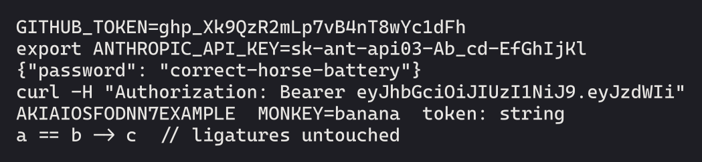
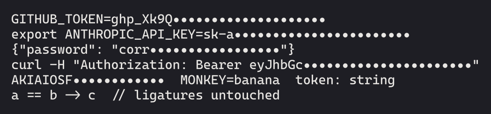
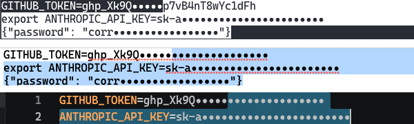
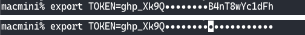

# `fontsecret`

`fontsecret` patches an OpenType font so it draws API keys, tokens and passwords as dots after their first 4 characters.

| Before | After |
|---|---|
|  |  |

> [!WARNING]
> This doesn't stop anyone, or any agent, from reading what the font hides. Copy/paste, files, shell history and the accessibility tree all get the real characters. Its only purpose is to hide secrets in screenshots, in screen sharing, and from someone looking over your shoulder.

`fontsecret` adds OpenType substitution rules to any font. When the font draws a known prefix such as `ghp_` or `TOKEN=`, it keeps the next 4 characters and draws the rest of the token as dots. The technique is inspired by Cody Collier's Obel Mono (see [Credits](#credits)).

## Quick start

```sh
mise install && uv sync
uv run python -m fontsecret patch IN.ttf OUT.ttf
uv run python -m fontsecret verify IN.ttf OUT.ttf
```

`patch` writes a masked copy of `IN.ttf` to `OUT.ttf`. By default, masking is opt-in under the `MASK` feature tag (see [Feature tag](#feature-tag)), and the family name gets the suffix `Masked` so the copy installs next to the original. `verify` checks the copy differs from the original only by masking.

`patch` options:

- `--feature TAG`: put masking under a different feature tag.
- `--always-on`: put masking in `ccmp`, which every app that shapes text applies. Use this for apps that can't turn on a feature.
- `--suffix TEXT`: append `TEXT` to the family name instead of `Masked`. `--suffix ""` keeps the original name.

To run the tests:

```sh
./scripts/build-samples.sh    # downloads OFL fonts into fonts/ and patches them
uv run pytest                 # 87 tests, shaped with HarfBuzz
```

## How masking works

Masking uses the same system fonts use for ligatures ("GSUB LookupType 6: Chained Contexts Substitution" if you want the technical phrasing), where certain combinations of characters lead to substitutes of similar characters. For example, if the "f" character is followed by an "i" character, they together get replaced with a tidier "fi" ligature glyph. `fontsecret` uses this to replace known secret patterns with dots.

1. A trigger, such as `ghp_` or `TOKEN=`, ends in a marker. The marker is a copy of the trigger's last glyph that looks identical but tells later rules a secret has started.
2. The 4 characters after the marker stay visible. Each character after that becomes a dot, as long as it belongs to the trigger's charset (such as `hex` or `b64url`).
3. The first character outside the charset ends the mask.

Every rule looks only at the glyphs before it. A glyph never changes after it's drawn, so text that is typed or streamed in never reveals a secret character before hiding it, not even for a single screen frame.

The triggers and charsets live in `patterns.toml`, with a source for each token format.

### What the patcher does

1. `fontsecret/fea.py` turns `patterns.toml` and the font's `cmap` into one lookup. Mask rules come before marker rules, so a trigger inside a masked run can't restart it. Without this, the `.eyJ` partway through a JWT revealed 4 characters.
2. `fontsecret/font.py` adds the dot and marker glyphs to `glyf` or `CFF` fonts, static or variable. Each marker copies the outline and `gvar` deltas of the glyph it replaces, so it draws and interpolates the same.
3. The lookup goes first in the font's GSUB, and every existing lookup reference is shifted to match. Masking sees the characters as typed, before the font's own ligatures and alternates change them.
4. `--always-on` attaches the lookup to `ccmp`, which shapers always apply. Otherwise it attaches the lookup to `MASK`, or to the tag given with `--feature`.

The patcher leaves every table it doesn't need to change byte for byte as it was.

Triggers that contain a space also match a non-breaking space, because VS Code draws some spaces as U+00A0.

## Checking a patched font

A font decides what text looks like. A malicious font could draw `ls` where the text says `curl evil.sh | sh`. So before you install a font someone else patched, run:

```sh
uv run python -m fontsecret verify ORIGINAL PATCHED
```

It exits 1 unless all of these hold:

- Every original glyph keeps its outline, variation data and metrics, and every character maps to the same glyph.
- Each added glyph is a dot (one shape, inside one cell) or draws exactly like an original glyph.
- Added lookups only replace a glyph with a dot or with a glyph that draws and varies exactly like it.
- Every original lookup, feature and script is unchanged, apart from the added feature.
- Every other table is byte-identical, except fields that must change when glyphs are added, such as `hhea.numberOfHMetrics`.

`tests/test_verify.py` makes six hostile edits to a patched font and checks `verify` rejects each one, on both a `glyf` and a `CFF` font:

- `cmap` draws `l` as `s`
- `a` redrawn as `o`
- a marker that draws as a different glyph
- an added substitution of `a` with `b`
- an edited original lookup
- an opt-in lookup attached to an always-on feature

## Where it's tested

- **HarfBuzz** (`tests/test_masking.py`, on variable Cascadia Code and CFF Source Code Pro):
  - 24 masking cases, including near-misses like `MONKEY=banana`.
  - For 324 lines, every prefix draws as the start of the whole line, so nothing is redrawn as text arrives. A planted lookahead rule fails this test.
  - Code without secrets shapes exactly as in the original font, under each of its features.
  - Every output passes OTS and `verify`.
- **Every Nerd Fonts family:** `scripts/survey.py` runs the same checks on one face of each of the 71 families in Nerd Fonts' `src/unpatched-fonts/`. All 71 pass ([table](docs/nerd-fonts-survey.md)).
- **CoreText:** `scripts/coretext_check.swift` shapes with the macOS engine and gets the same result as HarfBuzz ([render](docs/coretext-mask.png)).
- **Real apps**, driven with [agent-desktop](https://github.com/vercel-labs/agent-desktop) by `scripts/real-apps.sh` (`real-apps.sh uninstall` removes what it installs):

  | App | Build | Result |
  |---|---|---|
  | Ghostty 1.3.1 | `font-feature = +MASK` | Masked ([capture](docs/real-ghostty-mask.png)) |
  | TextEdit | always on | Masked ([capture](docs/real-textedit-masked.png)) |
  | TextEdit, one key typed every 200 ms | always on | No frame showed more than the 4 kept characters ([frames](docs/real-textedit-typing.png)) |
  | VS Code | `editor.fontLigatures: "'MASK', 'calt'"` | Masked in `.env` ([capture](docs/real-vscode-env.png)) and in JSON, with and without a space after the colon ([capture](docs/real-vscode-json.png)) |

DirectWrite (Windows), iTerm2 and Terminal.app are untested.

### Selection and the cursor

Ghostty can reveal part of a key when you select text or move the cursor into it. TextEdit and VS Code don't.

A selection paints a background behind glyphs that are already shaped, so it doesn't change them. The problem is an app that shapes the text on each side of a selection edge or the cursor as a separate run. The rules only look backwards, so the run after the split has no marker before it and draws as typed.

In this capture the selection starts inside the dots of the first key and ends after the password line.



| App | Selection starting inside a key | Select all | Cursor inside a key |
|---|---|---|---|
| Ghostty 1.3.1 | Shows the selected part of the key ([video](docs/demo/ghostty.mp4)) | Masked | Shows the key from the cursor on, unless `font-shaping-break = no-cursor` |
| TextEdit | Masked ([video](docs/demo/textedit.mp4)) | Masked | Masked |
| VS Code | Masked, the selected dots change colour ([video](docs/demo/vscode.mp4)) | Masked | Masked |

Ghostty splits the shaping run at the cursor by default (`font-shaping-break = cursor`) so you can see the separate characters of a ligature you're editing. Setting `font-shaping-break = no-cursor` keeps a key masked with the cursor inside it. No setting stops the split at a selection edge.



## Limits

- Masking changes pixels, not text. Anything that reads the text gets the secret, including AI agents reading the accessibility tree. Rotate any key that has been shown.
- Masking works within one shaping run. A key that wraps shows on its second line. Terminals that don't shape text, such as Alacritty, show everything.
- Text typed before existing text on the same line joins the open key until the line ends.
- On macOS, CoreText uses a font's AAT `morx` table instead of GSUB. ProFont is the only Nerd Fonts family with one.
- `CFF2` variable fonts aren't supported.
- `--suffix` only appends to the family name. A font with a Reserved Font Name, such as Source Code Pro ("Source"), needs a full rename before you share a modified copy.

## Feature tag

`fontsecret` uses the private tag `MASK` for opt-in masking.

Obel Mono uses the [`ss01` Stylistic Set 1](https://learn.microsoft.com/en-us/typography/opentype/spec/features_pt#ssxx) tag. This is a problem for us, though, because a font that already uses `ss01` can't be patched to use it for masking. 30 of the 71 Nerd Fonts families already use `ss01`, and at least one family uses each tag from `ss01` to `ss20`. Technically, lowercase tags (like `calt` or `ss01`) are registered OpenType tags, and I wouldn't really consider this feature to be a "Stylistic Set".

This is why I'm proposing that any font that adopts masking directly standardizes around the `MASK` tag.

The OpenType spec reserves tags of four uppercase letters for private features, so `MASK` can't collide with a registered tag. Fonts have no prefix convention like HTTP's `X-`. Private tags are 4-letter abbreviations instead, such as Iosevka's `HSKL` (Haskell ligatures) and `JSPT` (JavaScript). None of the 71 Nerd Fonts families uses `MASK`.

`--feature MASK` works in HarfBuzz, CoreText, Ghostty and VS Code, and passes OTS. Tags are case-sensitive, so `mask` does nothing. One downside to using a private tag is that it can't carry a display name for font menus. This is not so bad with a tag like `MASK`, since its name pretty directly describes the feature.

There is a formal process for proposing an accepted OpenType tag, which would be to have two fonts publish `MASK` in their font features, and then propose lowercase `mask` for Microsoft's feature registry, with both fonts as evidence.

## Credits

[Cody Collier](https://x.com/codycollier) ([Typographic Systems](https://typographic.systems), [A90](https://a90.com)) designed secret masking in a font and built it into [Obel Mono](https://typographic.systems/obel-mono). `fontsecret` takes these ideas from Obel Mono:

- masking secrets with OpenType substitution rules
- rules that only look backwards, so typed or streamed text never shows a key before hiding it
- a marker glyph that records where a secret starts, and one mask glyph per charset
- keeping the first 4 characters visible, drawing the rest as dots, and ending the mask at the first character that can't be part of a key
- an always-on build next to an opt-in feature

`fontsecret`'s code, rules, glyphs and `patterns.toml` were written independently. Obel Mono (SIL OFL 1.1) was used only for study: decompiling its GSUB and comparing its output. Nothing from its font files is in this repository. `fontsecret` is not affiliated with or endorsed by Cody Collier.

## License

MIT. The fonts that `build-samples.sh` downloads keep their own licenses (SIL OFL 1.1 for every sample font).
